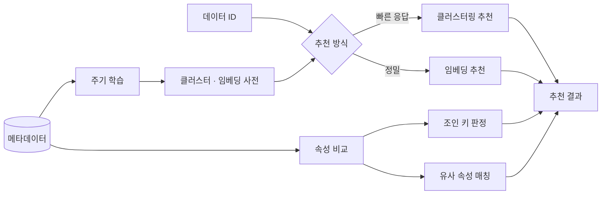

# Open VDAP Relate

[](LICENSE)


## 개요

데이터패브릭 기술을 적용한 서비스 명칭은 **Open VDAP**이며, 본 저장소는 Open VDAP을 구성하는 요소 중 **Relate**입니다.

수집된 데이터 사이의 **유사성과 결합 가능성**을 판정합니다. 데이터 ID를 입력하면 관련 데이터를 추천하고, 서로 다른 데이터의 속성이 같은 의미인지, 조인이 가능한지를 산출합니다. 데이터 카탈로그에서 연관 데이터 탐색과 논리적 데이터 통합의 근거로 사용됩니다.

## 기능

- **유사 데이터 추천**
  - 클러스터링 기반 — 빠른 응답
  - 임베딩 기반 — 높은 정밀도
- **신규 데이터 분류** — 수집된 데이터에 적합한 카탈로그 추천
- **융합 추천** — 컬럼 쌍의 조인 가능성과 관계 유형(1:1, 1:N) 판정
- **유사 속성 탐지** — 서로 다른 데이터의 속성을 컬럼 단위로 매칭
- **데이터 카테고리** — 주제별 분류와 카테고리 간 연결 그래프 산출
- **표준 용어 매핑** — 컬럼명의 표준 용어·단어·도메인 준수 판정
- **주기 학습** — 임베딩 사전 생성을 스케줄러로 주기 실행

## 동작 구조



학습과 추천이 분리되어 있습니다. 메타데이터로 사전을 미리 만들고, 요청 시점에는 사전을 조회해 응답합니다. 속성 비교는 사전과 별개로 메타데이터를 직접 읽어 컬럼 쌍을 평가합니다.

## 스펙

| 항목 | 버전 |
|---|---|
| Python | 3.12 |
| FastAPI | 0.112 |
| PyTorch | 2.4 |
| Transformers | 4.44 |

의존 패키지는 `requirements.txt`로 관리합니다. `torch`·`transformers`·`sentence-transformers`는 내려받는 용량이 큽니다.

## 구성

```
.
├── src/
│   ├── main.py                     애플리케이션 진입점
│   ├── app/
│   │   ├── server.py                 FastAPI 앱 구성
│   │   ├── routers/                  API 엔드포인트 (6파일)
│   │   ├── services/                 추천 알고리즘 (7파일)
│   │   ├── models/                   요청·응답 모델 (5파일)
│   │   └── init/                     설정 초기화
│   ├── standard_mapping/           표준 용어 매핑 (9파일)
│   │   ├── service/                  규칙·퍼지 매칭 (6파일)
│   │   └── model/
│   └── common/                     설정·로깅·예외 (11파일)
│       ├── config/
│       └── errors/
├── config_templates/               설정 템플릿 (2파일)
├── docker/                         이미지 빌드
├── docs/                           알고리즘 문서 (4파일)
├── Dockerfile
└── recommender.yml                 배포 매니페스트
```

## API

| 메서드 | 경로 | 역할 |
|---|---|---|
| `GET` | `/api/recommend/clustering` | 클러스터링 기반 유사 데이터 추천 |
| `GET` | `/api/recommend/embedding` | 임베딩 기반 유사 데이터 추천 |
| `GET` | `/api/recommend/cataloging` | 신규 데이터의 카탈로그 추천 |
| `GET` | `/api/recommender/training/clustering` | 클러스터링 학습 실행 |
| `GET` | `/api/recommender/training/embedding` | 임베딩 학습 실행 |
| `GET` | `/api/recommender/status` | 상태 확인 |

추천 API는 `target_id`를 질의 문자열로 받습니다.

```bash
curl "http://localhost:8080/api/recommend/clustering?target_id=<데이터 ID>"
```

응답은 `BaseCommonModel` 구조를 공통으로 사용합니다. Swagger 문서는 로컬 실행 시 `/recommender/docs`에서 확인합니다.

## 알고리즘

| 기능 | 방식 | 구현 |
|---|---|---|
| 클러스터링 추천 | 메타데이터 텍스트를 TF-IDF로 벡터화하고 코사인 유사도로 근접 데이터 선별. 사전 학습한 클러스터를 사용해 응답이 빠릅니다 | `app/services/` |
| 임베딩 추천 | 문장 임베딩으로 의미 유사도를 계산합니다. 처리 시간이 길어 주기 실행으로 사전을 미리 만듭니다 | `app/services/column_embedding.py` |
| 조인 키 판정 | 컬럼 쌍마다 자료형 일치, 값 겹침, 고유값 비율, 컬럼명·의미 유사도를 결합해 점수화합니다. 고유값 비율로 관계 유형을 판정하고 임계값을 넘는 쌍만 후보로 제시합니다 | `app/services/fusion_scorer.py` |
| 유사 속성 탐지 | 컬럼 단위 임베딩으로 유사도 행렬을 만들고 최적 할당으로 일대일 대응을 구성합니다. 이름이 달라도 의미가 같은 속성을 찾습니다 | `app/services/similar_attr.py` |
| 카테고리 그래프 | 데이터를 주제별로 묶고 카테고리 사이의 연결 강도를 산출합니다 | `app/services/category_graph_builder.py` |
| 표준 용어 매핑 | 컬럼명을 토큰화해 표준 단어·용어·도메인 규칙과 대조합니다. 규칙으로 판정하지 못하면 퍼지 매칭으로 후보를 제시하고, 자료형이 표준 도메인에 맞는지 확인합니다 | `standard_mapping/` |

알고리즘별 상세는 [docs/](docs/)에 정리되어 있습니다.

## 설정

`config_templates/config.yml`을 복사해 사용합니다.

| 섹션 | 키 | 설명 |
|---|---|---|
| `server` | `host`·`port`·`workers`·`process_timeout` | 서비스 바인딩과 워커 수 |
| `log` | `logfile`·`level` | 로그 파일 경로와 수준 |
| `database` | `dialects`·`host`·`port`·`id`·`pw`·`db` | 학습 데이터·추천 결과 저장소 |
| `open_metadata` | `host`·`port`·`id`·`pw`·`limit` | 메타데이터 조회 대상과 학습 건수 상한 |
| | `min_cluster_size`·`top_n` | 클러스터 최소 크기, 상위 추천 수 |
| `recommend_settings` | `recommended_count` | 응답에 담을 추천 개수 |
| | `clustering.trained_model_path` | 학습 결과 저장 경로 |
| `cron` | `hour`·`minute` | 주기 학습 실행 시각 |
| `sentry` | `enable`·`dsn` 등 | 오류 수집 연동 (기본 비활성) |

인증 정보는 설정 파일로 전달합니다. **저장소에 기록하지 않습니다.**

## 실행

```bash
python -m venv .venv
source .venv/bin/activate
pip install -r requirements.txt

cp config_templates/config.yml config.yml
mkdir -p logs

python src/main.py
```

컨테이너로 실행하는 경우입니다.

```bash
docker run -it --rm \
    -v ${ConfigFilePath}:/app/config_templates/config.yml \
    -p 8080:8080 \
    ${ImageName}:${ImageTag}
```

## 라이선스

[Apache-2.0](LICENSE)

인증 정보와 개인 환경 설정은 저장소에 등록하지 않습니다.

---

본 저장소는 아래 과제의 산출물입니다.

- 과제명: 분산된 데이터에 대한 논리적 데이터 통합과 복합분석을 지원하는 데이터 패브릭 기술개발
- 과제번호: RS-2023-00222191

관련 저장소: [DataFabricPlatform](https://github.com/DataFabricTech/DataFabricPlatform) · [DataFabricVisual](https://github.com/DataFabricTech/DataFabricVisual) · [ingestion](https://github.com/DataFabricTech/ingestion)
